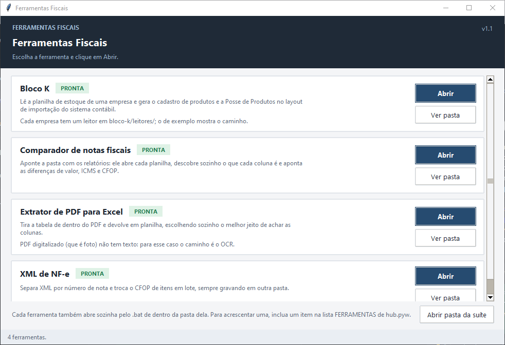
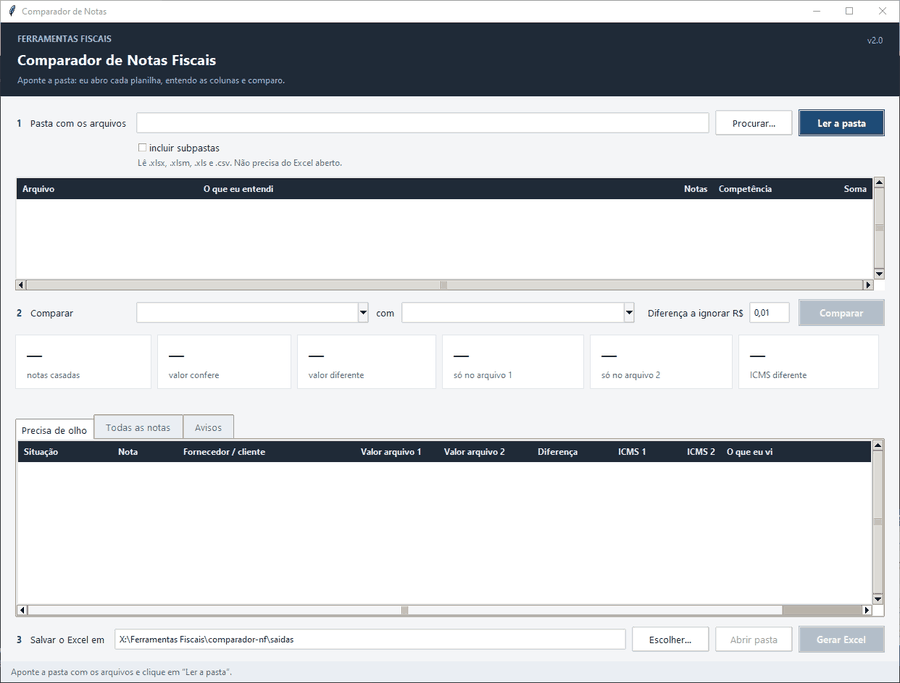

# Ferramentas Fiscais

Suíte de ferramentas de mesa, em Python e Tkinter, para o trabalho de rotina de um
departamento fiscal: conferir relatórios de notas fiscais, tirar tabelas de PDF, mexer
em lotes de XML de NF-e e montar o inventário (Bloco K) no layout de importação do
sistema contábil.

Tudo roda na própria máquina: sem servidor, sem navegador, sem internet e sem Excel
aberto. Precisa só do Python 3 e de quatro bibliotecas.



## Demonstração



*O comparador lendo os dois relatórios de exemplo, comparando e apontando as divergências plantadas.*

**[Baixar o pacote para Windows](https://github.com/DiogusVincere/ferramentas-fiscais/releases)** — um zip com
`Ferramentas Fiscais.exe`, que abre o hub **sem precisar instalar Python** nem biblioteca nenhuma. Descompacte
numa pasta qualquer e abra o executável; na primeira vez o Windows pode avisar que o editor é desconhecido
("Mais informações" → "Executar assim mesmo"). Os exemplos fictícios vêm dentro, na pasta `exemplos/` de cada
ferramenta, e as planilhas geradas ficam em `<ferramenta>/saidas/`.

Para montar o pacote a partir do código: `pip install pyinstaller` e `python build\empacotar.py` (ver
[`build/`](build/)). Os prints de cada tela estão nos READMEs das ferramentas e em [`docs/prints/`](docs/prints/).

## As ferramentas

| Ferramenta | O que faz | Pasta |
|---|---|---|
| **Hub** | Tela única que lista as ferramentas, diz se as bibliotecas de cada uma estão instaladas (e instala o que falta) e abre cada tela. Também guarda o tema visual compartilhado. | [`hub/`](hub/) |
| **Comparador de Notas** | Compara dois relatórios de notas fiscais (portal × sistema, por exemplo) vindos de .xlsx, .xls ou .csv. Descobre o papel de cada coluna **pelo conteúdo**, não pelo título; casa as notas por chave de acesso, CNPJ + número ou só número; aponta valor, ICMS e CFOP diferentes e sugere a nota parecida quando uma ficou sem par. | [`comparador-nf/`](comparador-nf/) |
| **Extrator de PDF** | Tira a tabela de dentro de um PDF em três modos (grade, alinhamento das palavras, uma linha por célula) ou automático, e grava em .xlsx. Detecta PDF digitalizado. | [`pdf-extrator/`](pdf-extrator/) |
| **XML de NF-e** | Separa XMLs por número de nota e troca CFOP de itens em lote, sempre em dois tempos (conferir → executar) e gravando cópias: o original não é tocado. | [`xml-nfe/`](xml-nfe/) |
| **Bloco K** | Lê a planilha de estoque de uma empresa (cada layout tem um "leitor" plugável) e gera as duas planilhas padronizadas de importação do inventário: cadastro de produtos e Posse de Produtos. Avisa quando a planilha trocou a ordem das colunas mantendo os títulos. | [`bloco-k/`](bloco-k/) |

Cada pasta tem um `README.md` próprio e uma subpasta `exemplos/` com dados fictícios para
experimentar.

## Instalar

1. Instale o [Python 3](https://www.python.org/downloads/) (3.11 ou mais novo; testado com
   3.14), marcando a opção de incluir no PATH. O Tkinter já vem junto.
2. Na pasta do repositório:

   ```bat
   pip install -r requirements.txt
   ```

As bibliotecas são `openpyxl`, `xlrd`, `pdfplumber` e `lxml` (mais `Pillow`, usado só por um
gerador de exemplo). O hub também mostra o que falta e tem um botão que roda o `pip`.

## Abrir

- **Tudo pelo hub:** dois cliques em `Abrir Ferramentas.bat` (ou `pythonw hub\hub.pyw`).
- **Uma ferramenta só:** o `.bat` de dentro da pasta dela, ou o `.pyw` direto:

  ```bat
  pythonw comparador-nf\comparador.pyw
  pythonw pdf-extrator\extrator.pyw
  pythonw xml-nfe\xml_nfe.pyw
  pythonw bloco-k\bloco_k.pyw
  ```

Os `.bat` e o atalho de abertura são para Windows. Os módulos de regra (`nf/`, `pdfx.py`,
`nucleo_xml.py`, `blocok/`) são Python puro e funcionam em qualquer sistema; a única parte
que depende do Windows é a leitura de `.xls` no Bloco K, que abre o Excel via PowerShell
(o comparador lê `.xls` com `xlrd`, sem Excel).

## Experimentar com dados fictícios

Nenhuma ferramenta precisa de dados reais para ser testada. Cada uma traz um gerador de
exemplo em `exemplos/`:

```bat
python bloco-k\exemplos\gerar_planilha_exemplo.py
python comparador-nf\exemplos\gerar_relatorios_exemplo.py
python pdf-extrator\exemplos\gerar_pdf_exemplo.py
python xml-nfe\exemplos\gerar_xmls_exemplo.py
```

Os READMEs de cada ferramenta dizem o que esperar de cada exemplo (as divergências
plantadas no comparador, os avisos do Bloco K etc.).

## Estrutura

```
ferramentas-fiscais/
├── Abrir Ferramentas.bat        abre o hub (pythonw hub\hub.pyw)
├── requirements.txt
├── build/                       lancador.py, ferramentas.spec e empacotar.py: o pacote portátil (PyInstaller)
├── docs/prints/                 prints e GIF usados nos READMEs
├── hub/
│   ├── hub.pyw                  a tela do hub; a lista FERRAMENTAS é a fonte da verdade
│   └── tema.py                  paleta, estilos ttk, faixa do topo e a classe Tabela
├── comparador-nf/
│   ├── comparador.pyw           tela
│   ├── nf/                      planilha.py (leitura), entender.py (papel das colunas),
│   │                            comparar.py (casamento), saida.py (Excel)
│   └── exemplos/                gerar_relatorios_exemplo.py
├── pdf-extrator/
│   ├── extrator.pyw             tela
│   ├── pdfx.py                  os três modos de extração e o Excel
│   └── exemplos/                gerar_pdf_exemplo.py, tabela-exemplo.pdf, digitalizado-exemplo.pdf
├── xml-nfe/
│   ├── xml_nfe.pyw              tela com as duas abas
│   ├── nucleo_xml.py            planejar/executar separação e troca de CFOP
│   └── exemplos/                gerar_xmls_exemplo.py, 1001_nfe-exemplo.xml, 1002_nfe-exemplo.xml
└── bloco-k/
    ├── bloco_k.pyw              tela
    ├── blocok/                  nucleo.py (modelos, conversões, consolidação, avisos),
    │                            planilha.py (leitura), saidas.py (as duas planilhas)
    ├── leitores/                um .py por empresa: exemplo.py (funcional) e _modelo.py (molde)
    └── exemplos/                gerar_planilha_exemplo.py, estoque-exemplo.xlsx
```

## Como as telas são feitas

- Todas importam a paleta e os estilos de `hub/tema.py`; nenhuma tem cores próprias.
- O trabalho pesado (abrir planilhas, ler PDFs, varrer pastas) roda numa thread e volta por
  fila, então a janela não congela. As variáveis do Tkinter são lidas antes de a thread
  começar.
- O que mexe em arquivo é sempre em dois tempos: primeiro a prévia, depois o botão que
  executa. Nada é sobrescrito sem perguntar.
- As pastas `saidas/` e os arquivos `config.json` e `*.log` que as telas criam ficam fora do
  Git (`.gitignore`).

## Licença

[MIT](LICENSE).
