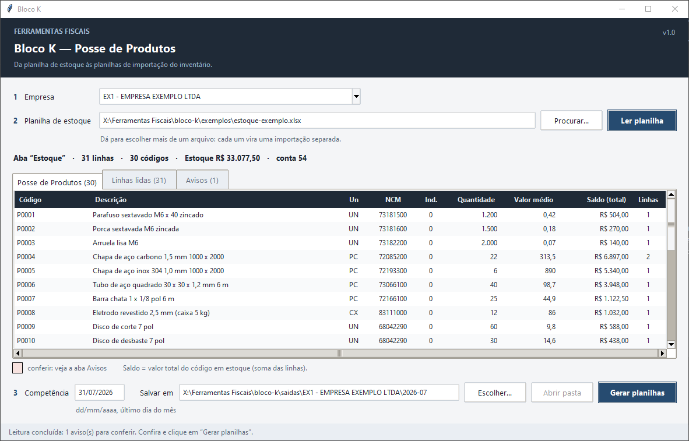

# Bloco K — Posse de Produtos

Cada empresa manda a planilha de estoque num layout próprio. A ferramenta lê essa planilha
por um **leitor** feito para aquele layout e gera **dois `.xlsx` padronizados, iguais para
todas as empresas**, no layout de importação de inventário do sistema contábil (Domínio):

1. `BLOCO K - JULHO2026 - CADASTRAR NO DOMINIO.xlsx` — cadastro de produtos: um código por
   linha com descrição, unidade, NCM e conta contábil (quantidade, valor e total zerados).
2. `BLOCO K 072026 modelo Dominio.xlsx` — Posse de Produtos: registro 01 com a competência
   e um registro 02 por código, com quantidade, **Saldo** e conta contábil.

O CSV que o sistema importa é gerado à mão a partir desses arquivos (Salvar como CSV no
Excel), por isso a ferramenta não gera CSV.



## Como usar

1. Escolha a **empresa** (cada uma tem um leitor em `leitores/`).
2. Escolha a **planilha de estoque** — ou várias de uma vez: cada arquivo vira uma
   importação separada, diferenciada por um sufixo no nome de saída — e clique em
   **Ler planilha**.
3. Confira as abas **Posse de Produtos**, **Linhas lidas** e **Avisos**, a competência
   (último dia do mês) e a pasta de saída, e clique em **Gerar planilhas**.

Por padrão as saídas vão para `saidas\<empresa>\<ano-mês>`. A planilha de origem nunca é
alterada.

## Regras

- **Saldo = valor total do código em estoque.** Usa a coluna de total quando a planilha
  tem; senão, quantidade × valor unitário. Código repetido: quantidades e totais somados.
- Descrição, unidade e NCM vêm da primeira linha do código; divergência entre linhas vira
  aviso.
- NCM ausente sai como `00000000`; NCM que perdeu o zero da frente (7 dígitos) ganha o zero
  de volta.
- O sistema contábil guarda só os **14 últimos caracteres** do código do produto: código
  maior vira aviso "Código longo".
- **"Coluna trocada":** em um layout real a empresa trocou a ordem das colunas e deixou os
  títulos no lugar — o número da ordem de serviço entrou como quantidade e o NCM como
  preço, e a Posse saiu na casa dos trilhões sem nenhum erro. Por isso `nucleo.conferir`
  olha a planilha inteira (NCMs sem 8 dígitos, preços unitários absurdos, coluna de total
  vazia) e põe um aviso só, no topo, em vez de dezenas de avisos item a item.
- Competência: cada leitor define a ordem das fontes (pasta do mês, nome do arquivo,
  cabeçalho da planilha…) e avisa se elas discordarem; sem nenhuma, a tela pede.

## Leitores

`leitores/` tem um `.py` por empresa, descoberto automaticamente (arquivos que começam com
`_` são ignorados). Contrato: `EMPRESA` e `ler(caminho) -> Leitura`; opcionais `CODIGO`,
`CONTA_CONTABIL` (padrão "54"), `INDICADOR_PROPRIEDADE` (0), `SEM_VALORES`,
`SEM_DESCRICAO` e `SEM_CONFERENCIA_TOTAL`.

- `exemplo.py` — leitor **funcional** para a Empresa Exemplo Ltda (código `EX1`): títulos
  `Código | Descrição | Unidade | NCM | Quantidade | Valor unitário | Valor total`
  (o total é opcional), competência pela pasta do mês, pelo nome do arquivo ou por uma
  data no cabeçalho da planilha.
- `_modelo.py` — molde comentado para uma empresa nova: copie com o nome da empresa,
  ajuste `EMPRESA`, `CODIGO`, `CONTA_CONTABIL`, a aba e os títulos.

## Experimentar com dados fictícios

```bat
python exemplos\gerar_planilha_exemplo.py
```

Gera `exemplos/estoque-exemplo.xlsx` (já vem versionado): 30 produtos inventados com
alguns casos plantados — um código em duas linhas (somado), um NCM que o Excel guardou
como número e perdeu o zero (devolvido), uma linha sem total (quantidade × unitário), um
código de 16 caracteres (aviso "Código longo") e uma linha de total no fim (ignorada).
Escolha "EX1 - EMPRESA EXEMPLO LTDA" na tela e leia esse arquivo: 31 linhas, 30 códigos,
competência 31/07/2026 (do cabeçalho da planilha), estoque de R$ 33.077,50.

Sem a tela:

```python
import sys; sys.path.insert(0, "bloco-k")
import leitores
from blocok import nucleo, saidas

m = next(m for m in leitores.carregar()[0] if m.CODIGO == "EX1")
l = m.ler("bloco-k/exemplos/estoque-exemplo.xlsx")
cons = nucleo.consolidar(l.itens, leitores.indicador(m))
avisos = nucleo.conferir(l.itens, cons, leitores.tem_valores(m), leitores.tem_descricao(m),
                         leitores.total_conferivel(m))
cad, mod = saidas.nomes_arquivos(l.competencia, l.sufixo)
saidas.gerar_cadastro(cons, l.conta or leitores.conta(m), cad)
saidas.gerar_modelo(cons, l.competencia, l.conta or leitores.conta(m), mod)
```

## Arquivos

- `bloco_k.pyw` — a tela (leitura em thread; vários arquivos por vez).
- `blocok/nucleo.py` — `ItemLido`, `Leitura`, `ItemConsolidado`, `Aviso`; conversões
  pt-BR (`numero`, `texto`, `ncm`, competência); `achar_cabecalho`/`achar_aba`;
  `consolidar`; `conferir`.
- `blocok/planilha.py` — `ler_aba`/`ler_abas`: .xlsx/.xlsm direto, .csv como texto, os
  demais pelo Excel (`converter_excel.ps1`, somente leitura, cópia temporária).
- `blocok/saidas.py` — `nomes_arquivos`, `gerar_cadastro`, `gerar_modelo`.
- `leitores/` — um leitor por empresa.

O sistema contábil espera o CSV da Posse com `;`, vírgula decimal e cp1252; linhas que
começam com "Tipo" são cabeçalho e os registros são 01 (competência) e 02 (itens).
