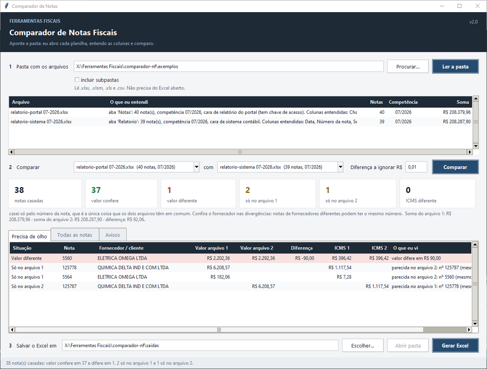

# Comparador de Notas

Compara dois relatórios de notas fiscais — por exemplo, o que o portal de notas devolve e
o que o sistema contábil escriturou — e diz, nota a nota, o que confere e o que precisa de
olho.



## Como usar

1. Aponte a **pasta** onde estão os arquivos (.xlsx, .xlsm, .xls ou .csv) e clique em
   **Ler a pasta**. A ferramenta abre cada planilha, acha onde a tabela começa, descobre o
   que cada coluna é e escreve em português o que entendeu ("aba 'Notas': 40 nota(s),
   competência 07/2026, cara de relatório do portal. Colunas entendidas: Chave da NFe,
   Número da nota, …").
2. Confira o par que ela sugeriu (dá para trocar nas caixas) e clique em **Comparar**.
3. Veja o placar, a aba **Precisa de olho** e gere o Excel.

## O que ela faz de diferente

- **Descobre o papel das colunas pelo conteúdo, não pelo título.** 44 dígitos é chave de
  acesso; 14 dígitos pouco variados é CNPJ; 4 dígitos começando em 1-7 é CFOP; a coluna
  que dá uns 18 % da outra é ICMS; coluna de data não é nada além de data. O título, quando
  existe, só reforça ou desempata. Isso é o que faz a ferramenta funcionar em relatório
  exportado de sistema que sai **sem título nenhum de coluna**, ou com cabeçalho esparso.
- **Limpa o relatório:** cabeçalho repetido a cada página, linhas de total e rodapé são
  deixados de fora, e a tela diz quantas linhas saíram e por quê.
- **Relatório por produto vira uma linha por nota:** soma quando o valor é quebrado por
  item, pega uma vez quando é o total da nota repetido; e busca ICMS e CFOP em outra aba
  do mesmo arquivo quando a aba escolhida não tem.
- **Casa pela chave mais firme que os dois lados tenham:** chave de acesso → CNPJ + número
  → só número, **sempre o mesmo modo nos dois lados**, e diz qual usou. Casando só pelo
  número, confere o nome do fornecedor e avisa quando é diferente (três ou mais notas com
  o mesmo par de nomes costumam ser a mesma empresa com razão social antiga e nova).
- **"Parecida com":** para cada nota sem par, procura do outro lado mesmo valor e/ou mesmo
  fornecedor. É assim que se acha a nota digitada com o número errado.
- Não compara CFOP quando um arquivo é de entrada e o outro de saída (são os dois lados da
  mesma operação) e descarta o mesmo relatório salvo em dois formatos.

A classificação de cada nota é sobre o **valor** (confere / valor diferente / só no
arquivo 1 / só no arquivo 2); ICMS e CFOP diferentes são marcas na linha.

## Saída

Um `.xlsx` com as abas **Resumo** (o que foi entendido de cada arquivo, como as notas
foram casadas, totais e avisos), **Todas as notas** e uma aba por situação (**Valor
diferente**, **So no arquivo 1**, **So no arquivo 2**, **ICMS diferente**, **Confere**).

## Experimentar com dados fictícios

```bat
python exemplos\gerar_relatorios_exemplo.py
```

Gera na pasta `exemplos/` dois relatórios com as mesmas 40 notas de oito fornecedores
inventados:

- `relatorio-portal 07-2026.xlsx` — título em toda coluna, chave de acesso, CNPJ, data,
  valor, ICMS e CFOP;
- `relatorio-sistema 07-2026.xlsx` — sem CNPJ, cabeçalho esparso (só "Nota", "Valor
  Contábil" e "Data" têm título), contador interno de lançamento, cabeçalho repetido e
  linha "Total Geral".

Aponte a pasta `exemplos/` na tela e compare. O resultado esperado:

| | |
|---|---|
| Casamento | só pelo número (um lado tem chave, o outro não tem CNPJ) |
| Notas casadas | 38 — 37 conferem, **1 com valor diferente** (nota 5560, R$ 90,00) |
| Só no portal | 2 — a **5564**, que não existe no sistema, e a **125778** |
| Só no sistema | 1 — a **125787**, que é a 125778 digitada errada; as duas linhas apontam uma à outra como "parecida" (mesmo valor, mesmo fornecedor) |
| Avisos | cabeçalho repetido e linha de total descartados; 5 notas com razão social antiga num lado e nova no outro |

O mesmo roteiro sem a tela, para testes:

```python
import sys; sys.path.insert(0, "comparador-nf")
from nf.entender import entender_arquivo
from nf.comparar import comparar
from nf import saida

a = entender_arquivo("comparador-nf/exemplos/relatorio-portal 07-2026.xlsx")
b = entender_arquivo("comparador-nf/exemplos/relatorio-sistema 07-2026.xlsx")
res = comparar(a, b, tolerancia=0.01)
print(res.explicacao_chave, res.totais)
saida.gerar(res, "Comparacao.xlsx")
```

## Arquivos

- `comparador.pyw` — a tela (Tkinter; leitura em thread, resultado por fila).
- `nf/planilha.py` — lê .xlsx/.xlsm (openpyxl), .xls (xlrd, sem Excel) e .csv/.txt
  (separador e codificação detectados), devolvendo sempre `Aba(nome, linhas)`.
- `nf/entender.py` — acha a linha de títulos, pontua cada coluna para cada papel, limpa o
  relatório, agrupa linhas por nota e explica o que entendeu.
- `nf/comparar.py` — escolhe o modo de casamento, compara, sugere parecidas e o par.
- `nf/saida.py` — o Excel do resultado.
