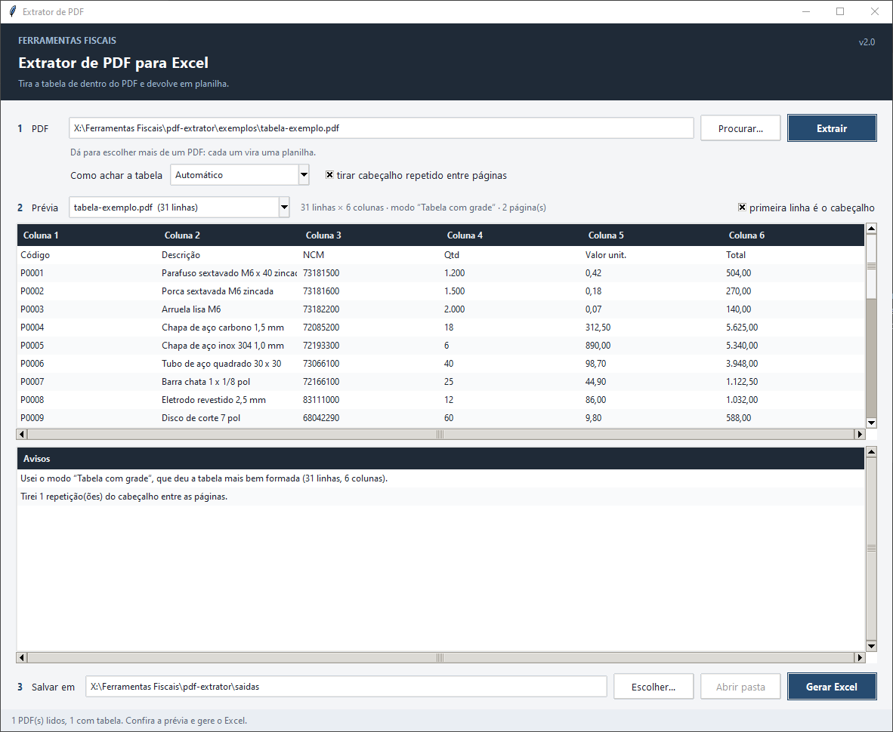

# Extrator de PDF

Tira a tabela de dentro de um PDF e devolve em `.xlsx`. Não depende de Ghostscript nem de
Java: só `pdfplumber` e `openpyxl`.



## Como usar

1. Escolha o PDF (ou vários de uma vez: cada um vira uma planilha) e clique em
   **Extrair**.
2. Confira a prévia e os avisos. A ferramenta diz o modo que usou e quantas linhas e
   colunas achou.
3. Gere o Excel.

## Os três modos

| Modo | Quando funciona |
|---|---|
| **Tabela com grade** | o PDF tem linhas desenhadas ou espaçamento regular; o pdfplumber acha as células |
| **Colunas pelo alinhamento** | não há grade: as palavras são agrupadas pela posição horizontal em que começam, como quem enxerga as colunas de um relatório alinhado |
| **Uma linha por célula** | último recurso: cada linha de texto vira uma célula só |

No modo **Automático** a ferramenta experimenta os três e fica com a tabela mais bem
formada (mais colunas e largura mais constante). Em qualquer modo, o cabeçalho repetido
entre páginas pode ser tirado.

PDF que é foto (digitalizado) não tem texto, e nenhum extrator lê imagem: a ferramenta
avisa em vez de devolver planilha vazia. Para esse caso o caminho é OCR.

## Experimentar com dados fictícios

```bat
python exemplos\gerar_pdf_exemplo.py
```

Escreve dois PDFs na pasta `exemplos/` (os dois já vêm versionados):

- `tabela-exemplo.pdf` — relatório de estoque fictício em duas páginas, com grade,
  cabeçalho repetido na segunda página e rodapé. O modo automático escolhe a grade e
  devolve **31 linhas × 6 colunas** (cabeçalho + 30 produtos), avisando que tirou uma
  repetição do cabeçalho. O PDF é escrito à mão pelo gerador, sem biblioteca.
- `digitalizado-exemplo.pdf` — uma página que é só imagem (precisa do Pillow para gerar).
  A ferramenta responde "Este PDF não tem texto: ele é uma imagem digitalizada".

Sem a tela:

```python
import sys; sys.path.insert(0, "pdf-extrator")
import pdfx
e = pdfx.extrair("pdf-extrator/exemplos/tabela-exemplo.pdf", "auto")
print(e.modo, len(e.linhas), e.colunas, e.avisos)
pdfx.gerar_excel(e, "tabela.xlsx", primeira_linha_e_cabecalho=True)
```

## Arquivos

- `extrator.pyw` — a tela.
- `pdfx.py` — `extrair(caminho, modo, tirar_repetidos)` devolve uma `Extracao` (modo,
  linhas, páginas, avisos, qualidade); `gerar_excel()` grava o `.xlsx`.
