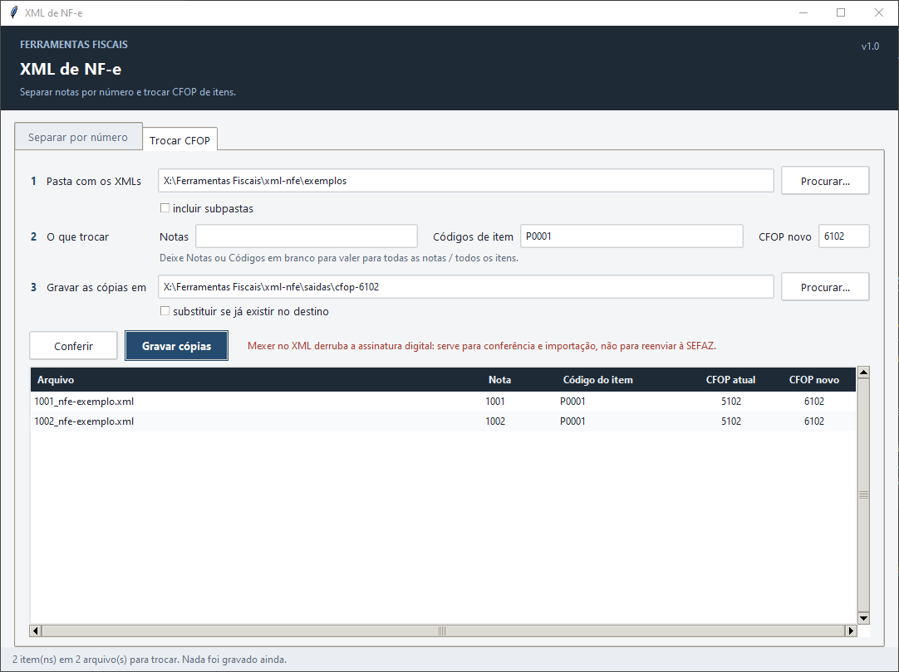

# XML de NF-e

Duas operações em lote sobre XMLs de NF-e, as duas em **dois tempos**: **Conferir** só olha
e mostra o que vai acontecer; o botão de executar só age depois. Mexeu num campo, o plano
é descartado e é preciso conferir de novo.



## Separar por número

Move (ou copia) para outra pasta os XMLs de certas notas. Os números vão um por linha ou
separados por vírgula/espaço. A busca é pelo nome do arquivo (`12345_….xml`) e, se marcado,
também pelo `nNF` de dentro do XML (mais devagar). Arquivo que já existe no destino não é
sobrescrito; dois arquivos de subpastas diferentes com o mesmo nome são apontados em vez de
um apagar o outro.

## Trocar CFOP

Grava **cópias** dos XMLs com o CFOP de certos itens trocado, numa pasta de saída que tem
de ser diferente da de origem. Filtra por nota e por código de item (em branco = todos).
O XML de origem nunca é alterado; num arquivo com mais de uma NF-e, só a nota pedida é
mexida. O namespace e o bloco de assinatura são preservados.

> Mexer no XML derruba a assinatura digital: serve para conferência e importação, não
> para reenviar à SEFAZ. A tela avisa isso.

## Experimentar com dados fictícios

```bat
python exemplos\gerar_xmls_exemplo.py
```

Grava na pasta `exemplos/` (já vêm versionados) `1001_nfe-exemplo.xml` e
`1002_nfe-exemplo.xml`: estrutura mínima `nfeProc/NFe/infNFe`, namespace oficial, três e
dois itens com CFOP 5102/5405, e um bloco `Signature` de mentira. Não há CNPJ nem chave de
acesso — os nomes são inventados.

Na aba **Trocar CFOP**, aponte `exemplos/`, código de item `P0001`, CFOP novo `6102` e uma
pasta de saída qualquer: o plano lista um item em cada nota; depois de gravar, as cópias
têm `P0001` em 6102, os outros itens iguais, e os originais intactos.

Sem a tela:

```python
import sys; sys.path.insert(0, "xml-nfe")
from pathlib import Path
import nucleo_xml as nx
alts, erros = nx.planejar_cfop(Path("xml-nfe/exemplos"), notas=[], codigos=["P0001"],
                               cfop_novo="6102", incluir_subpastas=False)
print(nx.executar_cfop(alts, Path("saida-cfop"), substituir=False))
```

## Arquivos

- `xml_nfe.pyw` — a tela, com as duas abas.
- `nucleo_xml.py` — `planejar_separacao` / `executar_separacao` e `planejar_cfop` /
  `executar_cfop`, mais `ler_nota`, `separar_valores` e `mesma_pasta`. Procura as tags
  pelo nome, com ou sem namespace, para aceitar XML salvo de outro jeito.
